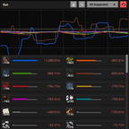

# Production Plus
*by Reiji_Kishigami*

**Your production statistics, plus the number that actually matters: net.**

Production Plus replaces the production window (same hotkey, same button) with a version that shows production, consumption **and net (produced minus consumed)** side by side. One glance tells you what you're short on and what's piling up. It's built to look and feel like vanilla, and to be light enough that you won't notice it running, even in a megabase.

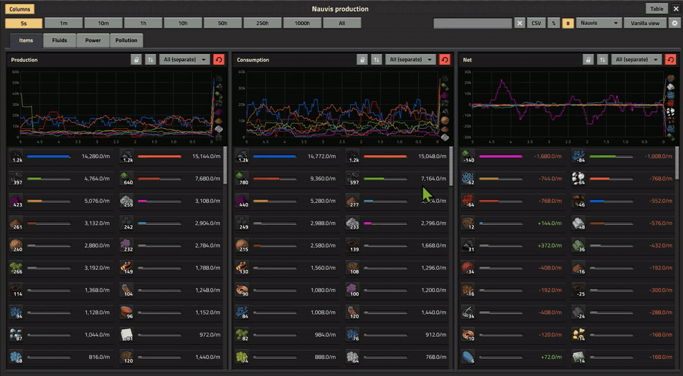

---

## Features

### Production, consumption and net, side by side
Every panel has its own graph, its own quality filter, and the same lines, colours and icons as vanilla. The Net panel shows deficits in red and surpluses in green, centred on a zero line.

### Every time scale
5s to All, just like vanilla, with smooth, continuously gliding graphs.

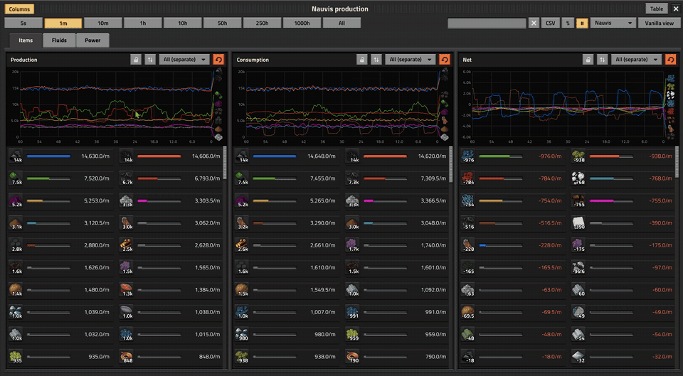

### Search
Type to filter every panel at once. It matches translated names, so it works in any language and with any mod.

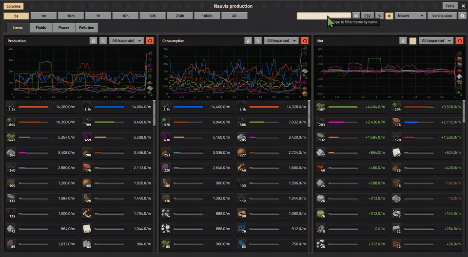

### Percentages or precise numbers
Switch between exact rates and percentages with one click. In percent mode, production and consumption show each item's share of the total, and net shows a percentage of the item's own production.

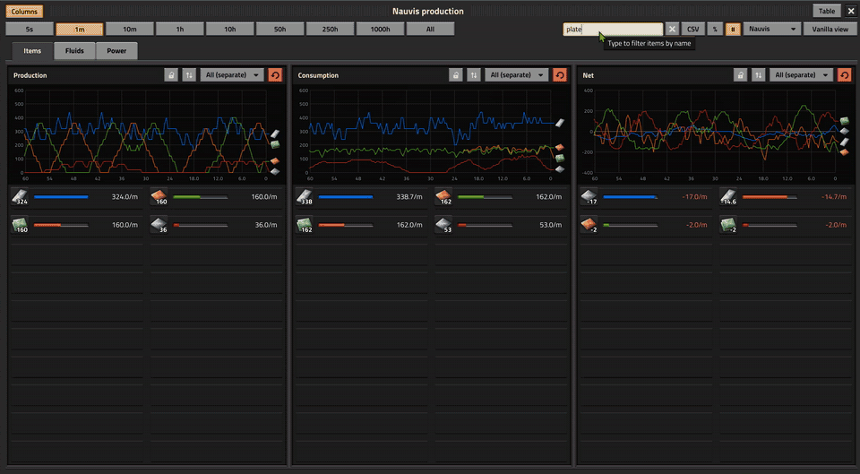

### Graph one item, pin the ones you care about
- **Click** an item to graph only that item. Click again to show everything.
- **Shift-click** to pin an item to the top of every panel, highlighted in yellow so you can always find it.
- Hover a line on the graph to highlight it.

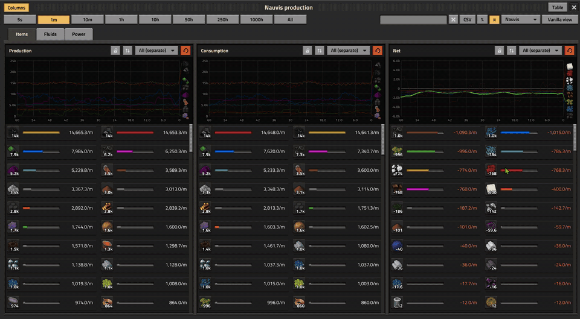

### Table view
One row per item: produced, consumed, net, net % and a deficit/surplus meter. Click any column header to sort, and click again to reverse.

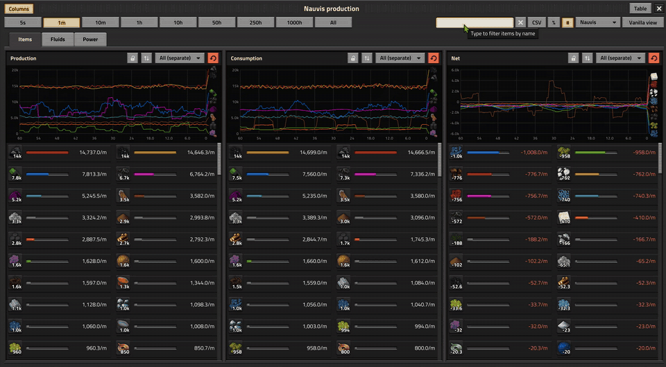

### Lock and flip
- **Lock** freezes the row order. Values keep updating, but rows stop jumping around.
- **Flip** reverses the sort, so the biggest surpluses come first instead of the biggest deficits.

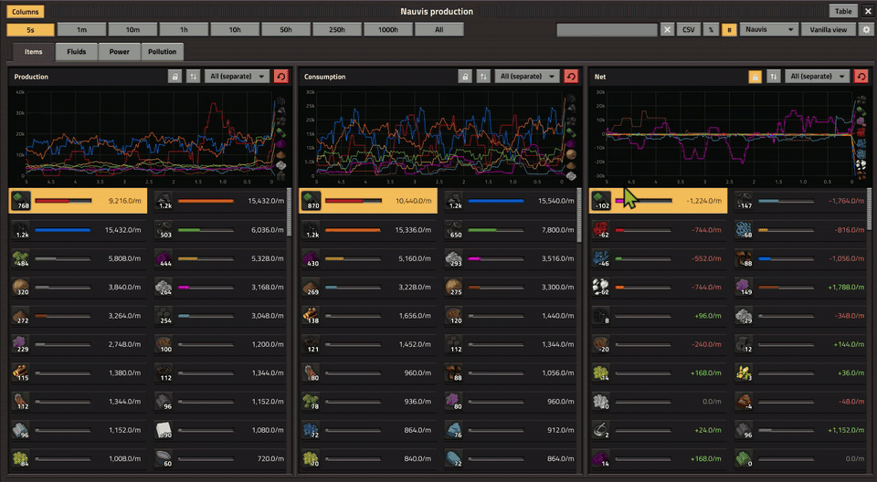

### Quality
Per panel: show every quality separately, merge them together, or pick a single quality.

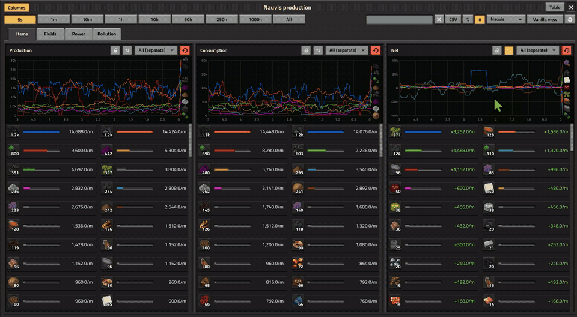

### Power tab
Every electric network on the surface in one list: production, demand, satisfaction, stored energy, accumulator charge and time until empty. Networks are labelled by direction and distance from spawn, and you can rename them.
- Click a network to graph it on its own, with a minimap preview.
- Idle networks are hidden, with one click to show them.

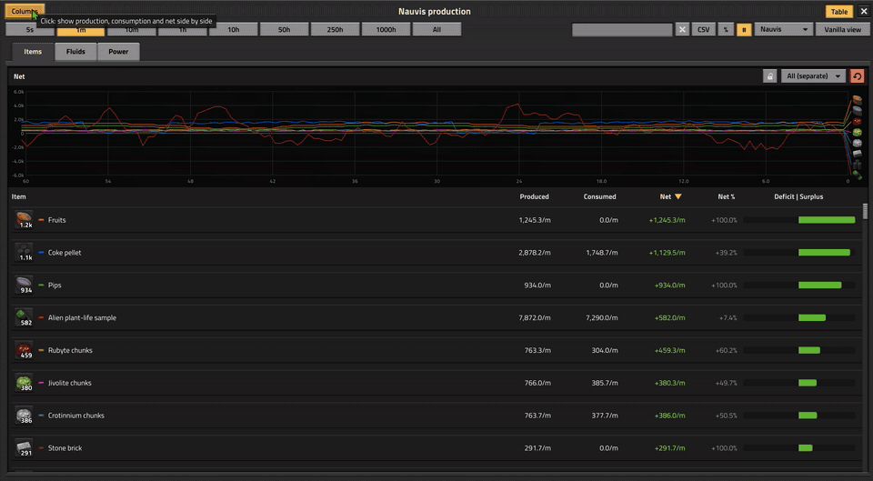

### Find producers and consumers on the map
Each network has two buttons, one that takes you to its **producers** and one to its **consumers**. Nearby buildings are outlined as a cluster, and clicking again jumps to the next cluster.

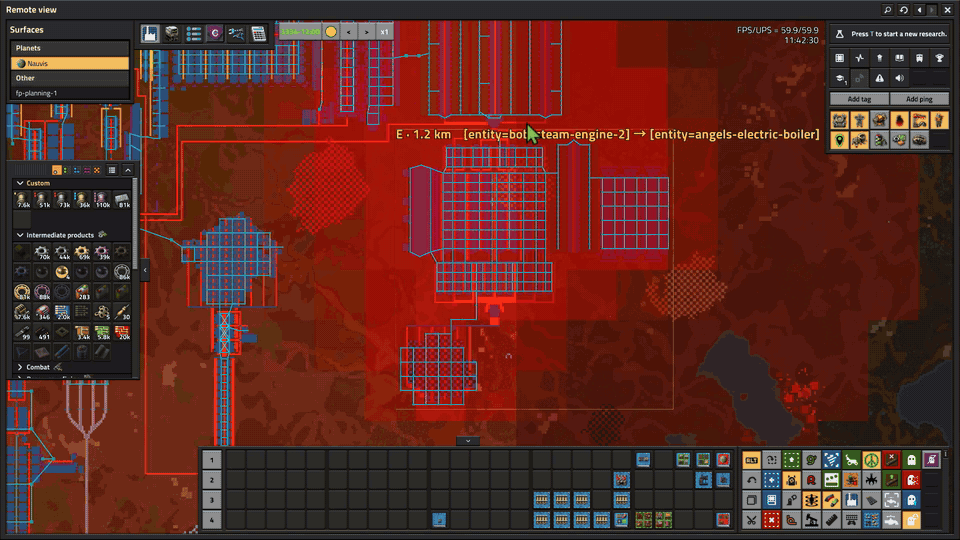

### CSV export
Exports the current view to `script-output/production-plus/` for spreadsheets.

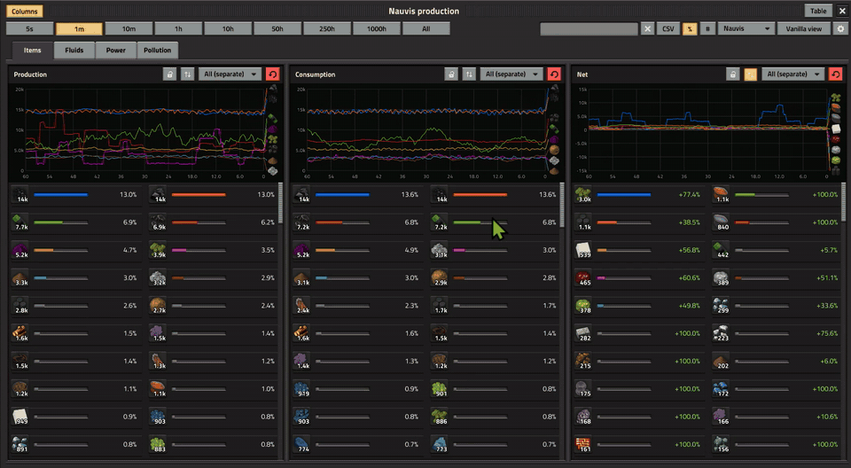

### Vanilla is one click away
The **Vanilla view** button opens the original window, which has its own button to come straight back. A per-player setting lets you choose:
- Production Plus by default
- Vanilla by default, with Production Plus one click away
- Production Plus only

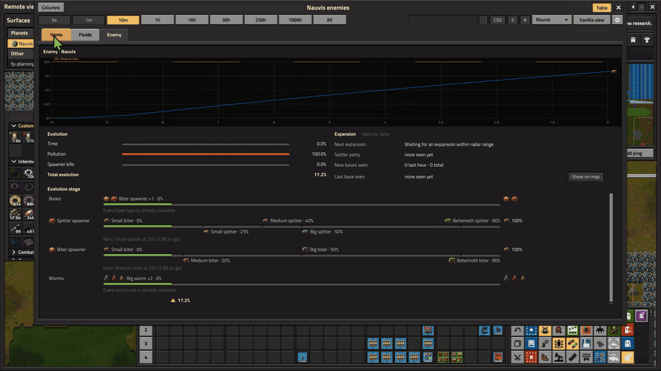

---

## Performance
Performance came first in every decision. The window only does work while it's open, the lists refresh in small slices spread across ticks, unchanged values are never rewritten, and the graphs are drawn once and panned rather than redrawn. Type `/pp-perf` with the window open to see exactly what it costs on your save.

## Compatibility
- Factorio 2.1. Works with Space Age, Quality and overhaul mods (Angel's, Bob's and others).
- Safe to add to an existing save, and safe to remove.
- Multiplayer-safe: all state is per player.
